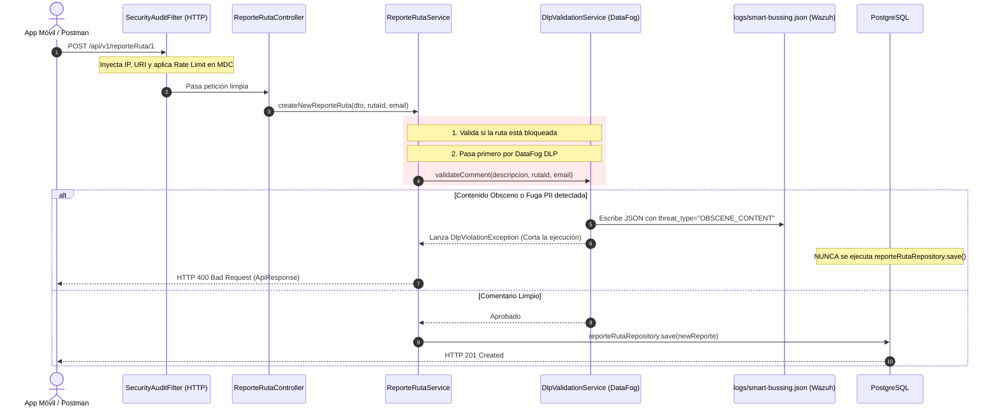
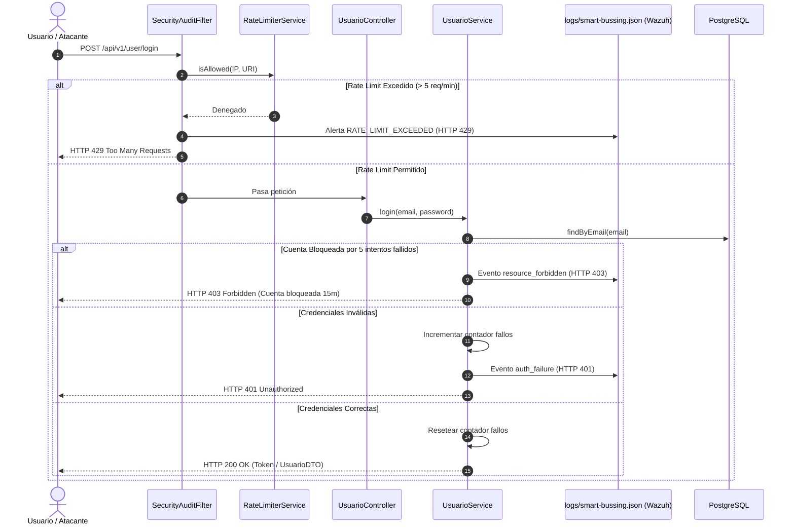

# SKILL: Architecture & Request Flow Diagrams

---
name: architecture-flow-diagrams
description: "Guidelines and standards for generating clear, comprehensive Mermaid sequence and flow diagrams documenting backend request lifecycles, security filters, microservices, and database persistence for Smart Bussing."
---

## Purpose
Document end-to-end request lifecycles across architectural layers in Smart Bussing. Whenever a new feature, security filter, or endpoint workflow is built or refactored, use this skill to generate a structured, visually clear Mermaid diagram showing both the happy path and rejection/failure branches.

## Architectural Layers to Represent
When charting any endpoint in Smart Bussing, always represent the participants in logical sequence:

1. **Cliente / Actor**: App Móvil (React Native), Web o Cliente API (Postman/Curl).
2. **Filtros HTTP / Middlewares (`SecurityAuditFilter`)**: Inspección de URI, headers de seguridad, Rate Limiting y contexto inicial MDC.
3. **Controlador (`*Controller`)**: Deserialización del payload JSON a DTO y validación de entrada.
4. **Servicio de Negocio (`*Service`)**: Orquestación de reglas de negocio, autorizaciones y bloqueos de recursos.
5. **Interceptores / Validadores / Microservicios (Sidecar / DLP / Mapbox)**: Motores especializados de validación o enriquecimiento de datos.
6. **Capa de Logging & SIEM (`logs/smart-bussing.json` -> Wazuh)**: Trazabilidad estructurada de eventos y alertas de seguridad.
7. **Capa de Persistencia (PostgreSQL / JGraphT)**: Base de datos transaccional o grafos en memoria.

## Diagram Rules & Standards
1. **Diagram Type**: Always prefer `sequenceDiagram` for request/response lifecycles, and `flowchart LR` / `flowchart TD` for module architecture.
2. **Numbering**: Always include `autonumber` in sequence diagrams to ease step-by-step review.
3. **Visual Highlighting**: Use `rect rgb(r, g, b)` blocks to highlight critical security validation, rate limiting, or threat detection zones.
4. **Branching (`alt / else / opt`)**: Explicitly document both success (`200 OK`, `201 Created`) and failure paths (`400 Bad Request`, `401 Unauthorized`, `403 Forbidden`, `429 Too Many Requests`).
5. **No Data Loss**: Show the exact moment logs are written to `logs/smart-bussing.json` before any exception terminates execution.

---

## EXAMPLES

### Example 1: DLP & Content Moderation Flow (`POST /api/v1/reporteRuta/{id_ruta}`)

### Example 2: Authentication & Account Lockout Flow (`POST /api/v1/user/login`)

