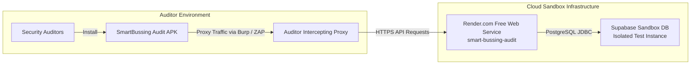

# Security Audit Sandbox Backend Setup Guide

This guide describes how to deploy the isolated **Cloud Sandbox Backend** and **Test Database** for third-party security audits and penetration testing without sharing source code or endangering production data.

---

## Architecture Overview



---

## Step 1: Provision the Sandbox Database (Supabase)

1. Log in to [Supabase](https://supabase.com) and create a **New Project** (e.g., `smartbussing-audit-db`).
2. Choose a strong database password and keep note of it.
3. Open the **SQL Editor** in Supabase and execute the following two files in exact order:
   1. **`database/schema_backup.sql`**: Creates tables, sequences, foreign keys, and indexes.
   2. **`database/audit_seed.sql`**: Disables table locks for test roles, seeds test credentials, and creates sample routes/coordinates.
4. Go to **Project Settings** -> **Database** -> **Connection string** -> **URI / JDBC**:
   * Format: `jdbc:postgresql://<db-host>:5432/postgres` (or pooler port 5432/6543)
   * Username: `postgres` (or `postgres.<project-ref>`)
   * Password: `<your-db-password>`

---

## Step 2: Deploy Backend to Render.com

1. Push your backend branch to GitHub (`origin`).
2. Log in to [Render](https://dashboard.render.com).
3. Click **New +** -> **Web Service**.
4. Connect the repository `Civza/smart-bussing-back` (select your audit branch).
5. Configure the service:
   * **Name**: `smart-bussing-audit` (yields `https://smart-bussing-audit.onrender.com`)
   * **Region**: Oregon (US West) or Ohio (US East)
   * **Runtime**: `Docker` (Render automatically uses the root `Dockerfile`)
   * **Instance Type**: `Free`
6. Under **Environment Variables**, add:
   * `SPRING_DATASOURCE_URL`: `jdbc:postgresql://<supabase-host>:5432/postgres`
   * `SPRING_DATASOURCE_USERNAME`: `postgres`
   * `SPRING_DATASOURCE_PASSWORD`: `<your-supabase-db-password>`
   * `MAPBOX_API_KEY`: `<your-mapbox-token>`
7. Click **Deploy Web Service**.
8. Verify healthcheck once deployed:
   ```bash
   curl -I https://smart-bussing-audit.onrender.com/api/v1/user
   ```

---

## Step 3: Test Account Matrix for Auditors

Provide these synthetic accounts to the penetration testing team:

| Role | Email | Password | Audit Purpose |
| :--- | :--- | :--- | :--- |
| **Admin** | `admin@audit.com` | `AdminPass123!` | Test administrative routes and privilege escalation |
| **Driver 1** | `driver1@audit.com` | `DriverPass123!` | Test driver routes and trip reporting |
| **Driver 2** | `driver2@audit.com` | `DriverPass123!` | Test Horizontal Privilege Escalation (IDOR between drivers) |
| **Passenger 1** | `passenger1@audit.com` | `PassengerPass123!` | Test user trips, public search, and reports |
| **Passenger 2** | `passenger2@audit.com` | `PassengerPass123!` | Test data isolation between distinct passengers (IDOR) |

---

## Step 4: Connecting the Mobile Build

Once the Render service is running, copy the base API URL:
`https://smart-bussing-audit.onrender.com/api/v1`

Pass this URL to the mobile app build step as detailed in `SmartBussingMobile/docs/AUDIT_BUILD_GUIDE.md`.
